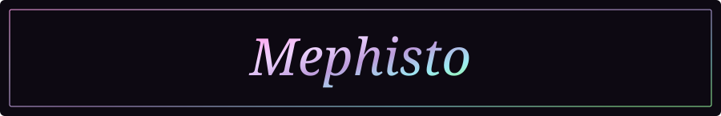
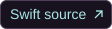
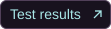
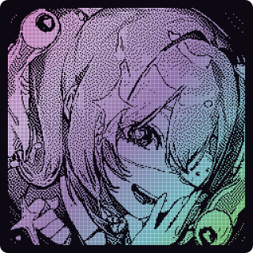
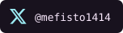
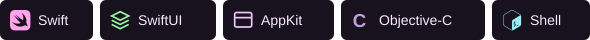
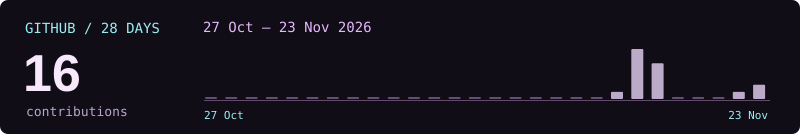

  

<strong>macOS developer</strong> · SwiftUI &amp; AppKit

<h2 align="center">About me</h2>

 &nbsp;  &nbsp; 

A native macOS app built with SwiftUI and AppKit.

 &nbsp;  &nbsp; 

A small Objective-C menu bar app that hides the Dock when a window fills the usable screen and brings it back when there’s room. Currently in development.

<h3 align="center">初音ミク · Hatsune Miku</h3>

<h3 align="center">Connect</h3>

  
  &nbsp;
  

<h3 align="center">Tech stack</h3>

<h3 align="center">GitHub activity</h3>

