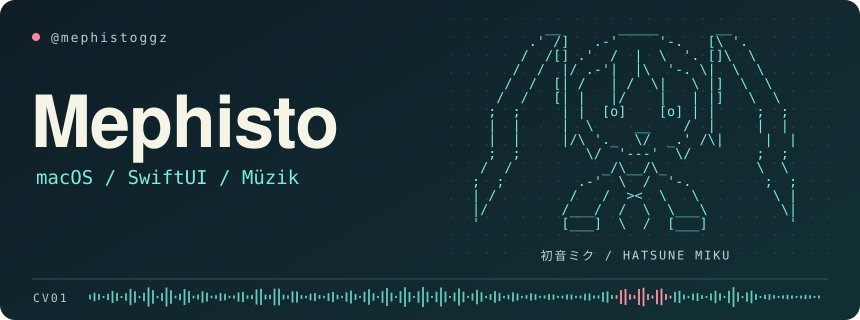

Selam, ben **Mephisto**. Mac için uygulamalar geliştiriyorum. Bir yanda şarkı sözlerini müzikle birlikte akıtan bir oynatıcı, diğer yanda Dock’un ne zaman görüneceğiyle ilgilenen küçük bir araç var.

### Projelerim

| Proje | Ne yapıyor? |
| :--- | :--- |
| [**Nocturne**](https://github.com/mephistoggz/nocturne) | YouTube Music ve yerel müzik arşivini bir SwiftUI oynatıcıda buluşturuyor. Senkronize şarkı sözleri ve mini oynatıcı içeriyor. |
| [**DockSense**](https://github.com/mephistoggz/DockSense) | macOS Dock’unun görünürlüğünü sistem olaylarına göre yöneterek düzenli durum kontrollerini azaltıyor. Geliştirme aşamasında. |

[Instagram · **@mefist0pheles**](https://www.instagram.com/mefist0pheles/)　/　[Twitter (X) · **@mefisto1414**](https://x.com/mefisto1414)
